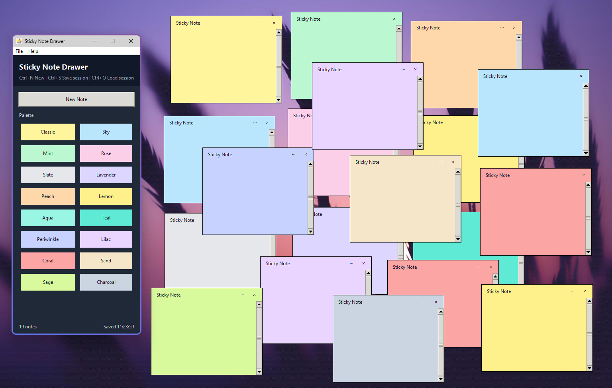

# StickyNotes for Windows

**Keep the little things in sight.** StickyNotes gives reminders, checklists, and quick ideas a place on your Windows desktop. Created by **Erick Omari**, it’s free to use and requires no activation key.

## What you can do

- Start a note in any of 16 colors from the Sticky Note Drawer.
- Drag and resize floating notes to fit your workspace.
- Double-click a note’s title bar to collapse it into a compact strip.
- Pick up where you left off with session autosave.

[Watch the demo](assets/Recording_20251223_113059.mp4) · [See the color palette](assets/Screenshot_20251223_112439.png) · [See collapsed notes](assets/Screenshot_20251223_112835.png)

## Install on Windows 10 or 11

1. Open [GitHub Releases](https://github.com/pitchiluxe/StickyNotes/releases) and download **StickyNotesSetup.exe** from **Assets**.
2. Run the installer and follow the prompts.
3. Open StickyNotes from the Start menu and choose **New Note**.

## Run from source

Run `python StickyNotes.py` on Windows with Python 3 and Tkinter. See [BUILD.md](BUILD.md) for packaging instructions and [LICENSE](LICENSE) for the MIT terms.
